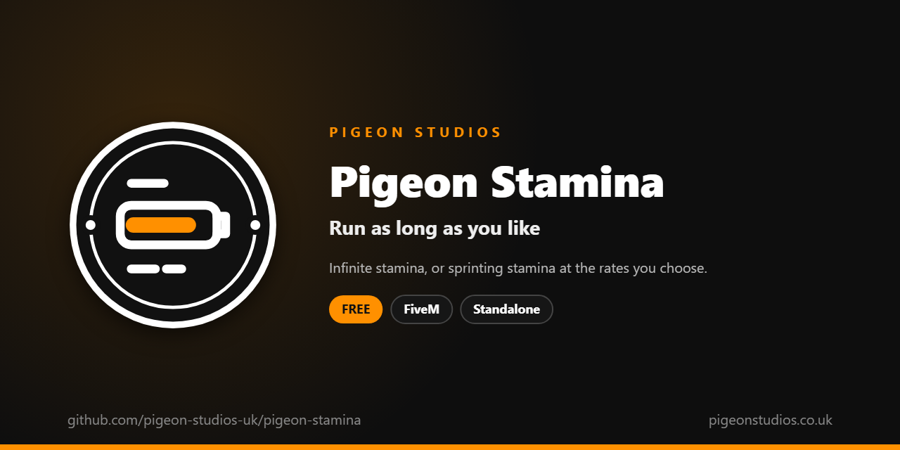

<div align="center">
  

  <h1>Pigeon Stamina</h1>

  <p><strong>Infinite stamina, or sprinting and swimming stamina that drains and recovers at the rates you choose.</strong></p>

  <p>
    <a href="https://github.com/pigeon-studios-uk/pigeon-stamina/releases/latest"></a>
    <a href="LICENSE.md"></a>
    <a href="https://discord.gg/2NFVWEUmDF"></a>
    
  </p>

  <p>
    <a href="https://github.com/pigeon-studios-uk/pigeon-stamina/releases/latest"><strong>Download</strong></a> ·
    <a href="#installation">Install</a> ·
    <a href="#configuration">Configure</a> ·
    <a href="CHANGELOG.md">Changelog</a> ·
    <a href="https://discord.gg/2NFVWEUmDF">Support</a>
  </p>
</div>

---

## Contents

- [Overview](#overview)
- [Features](#features)
- [Requirements](#requirements)
- [Installation](#installation)
- [Updating](#updating)
- [Configuration](#configuration)
- [How it works](#how-it-works)
- [Update checker](#update-checker)
- [Performance](#performance)
- [Security](#security)
- [Troubleshooting](#troubleshooting)
- [FAQ](#faq)
- [Support](#support)
- [Contributing](#contributing)
- [Licence](#licence)
- [Credits](#credits)

## Overview

Pigeon Stamina is a free resource by [Pigeon Studios](https://pigeonstudios.co.uk) that changes how long players can sprint and swim. GTA's stamina runs out quickly on a fresh character, and on a FiveM server characters never build it up the way they do in story mode.

Choose infinite stamina, so players can run and swim as long as they like, or keep stamina but set how fast it drains and how fast it comes back: a little longer than GTA's, much longer, or shorter for a more hardcore server.

## Features

- **Infinite stamina.** Sprint and swim forever, if you like.
- **Or your own rates.** Set how fast stamina drains, and how fast it recovers, separately.
- **Sprinting and swimming.** Both use the same stamina, so both change together.
- **Respawns left alone.** A full refill on respawn always goes through.
- **Standalone.** No framework or other resources needed.

## Requirements

| Requirement | Version | Notes |
|---|---|---|
| FXServer | A [recommended artifact](https://runtime.fivem.net/artifacts/) | |

**Frameworks:** none needed. It works the same on standalone and vMenu servers, ESX Legacy, QBCore, Qbox and ox_core.

## Installation

1. **Download** `pigeon-stamina.zip` from the [latest release](https://github.com/pigeon-studios-uk/pigeon-stamina/releases/latest). Don't use the green **Code** button; release zips are the tested builds.
2. **Extract** it into your server's `resources` folder. The folder must be called `pigeon-stamina`.
3. **Start it** by adding this to `server.cfg`:

   ```cfg
   ensure pigeon-stamina
   ```

4. **Configure** it in `configuration/config.lua`. Out of the box, stamina lasts twice as long as GTA's and recovers at GTA's own rate.
5. **Restart** your server. The console shows one line from the update checker:

   ```text
   [Pigeon Studios] Pigeon Stamina v1.0.0 is up to date.
   ```

## Updating

1. Read the [changelog](CHANGELOG.md) for every version between yours and the latest, especially any **Upgrade notes**.
2. Back up your `configuration/` folder.
3. Replace the `pigeon-stamina` folder with the new release.
4. Copy your changed settings into the new `configuration/config.lua`. Don't copy the old file over the new one; new versions can add settings.
5. Restart the resource.

## Configuration

All settings are in `configuration/config.lua`, each explained by a comment next to it.

| Setting | Default | What it does |
|---|---|---|
| `Config.Mode` | `'scaled'` | `'infinite'` keeps stamina full. `'scaled'` uses the two rates below |
| `Config.DrainMultiplier` | `0.5` | How fast stamina drains. `1.0` is GTA's rate, `0.5` lasts twice as long, `2.0` half as long |
| `Config.RecoverMultiplier` | `1.0` | How fast stamina comes back. `1.0` is GTA's rate, `2.0` twice as fast |

**Examples:**

```lua
-- Never run out.
Config.Mode = 'infinite'

-- Last three times as long, and recover twice as fast.
Config.Mode = 'scaled'
Config.DrainMultiplier = 0.33
Config.RecoverMultiplier = 2.0

-- Hardcore: run out sooner, recover slowly.
Config.Mode = 'scaled'
Config.DrainMultiplier = 1.5
Config.RecoverMultiplier = 0.5
```

## How it works

Ten times a second, the resource reads the player's stamina with FiveM's own `GetPlayerStamina`.

- With `'infinite'`, if it's below full, it puts it back to full with `SetPlayerStamina`.
- With `'scaled'`, it compares it with the last reading. If GTA took some away (sprinting or swimming), it sets stamina to the last reading minus that amount times `Config.DrainMultiplier`. If GTA gave some back (resting), it does the same with `Config.RecoverMultiplier`. A jump of more than a third of the bar at once, which is a respawn or another resource refilling it, is left as it is.

GTA still decides when the player is tired; this only changes the numbers it counts down from.

## Update checker

When it starts, Pigeon Stamina checks our public [version registry](https://github.com/pigeon-studios-uk/pigeon-versions) once and prints one line in the server console saying whether it's up to date. If there's an update, it shows what's new and where to get it. The check is a single request to GitHub and sends nothing about your server or players.

Control it for every Pigeon Studios resource at once in `server.cfg`:

```cfg
set pigeon_update_check "on"      # default: one line per resource
set pigeon_update_check "quiet"   # only when there's an update or a problem
set pigeon_update_check "off"     # never check
```

## Performance

It reads one number ten times a second, and sets it when it needs to. Nothing runs every frame, and nothing runs on the server apart from the update check at start-up.

## Security

- It runs only in each player's own game and only changes that player's stamina.
- It has no commands, exports or network events, so there is nothing other players, other resources or the server can send it.
- The only network request is the update check at start-up, from the server to GitHub. It sends nothing about your server or players.

Found a problem? Please don't open a public issue. Use the **Report a vulnerability** button in this repository's **Security** tab, or follow our [Security Policy](https://github.com/pigeon-studios-uk/.github/blob/main/SECURITY.md).

## Troubleshooting

**Stamina still runs out at GTA's normal rate.**
Check the resource is started and there are no errors in the F8 console. Another resource that sets stamina itself, such as a gym or skills resource, can fight with it; use one or the other for stamina.

**Players get tired straight after respawning.**
That's GTA's own stamina on respawn, which this resource leaves as it is. With `'infinite'` it's topped up within a tenth of a second.

**The console says "isn't in the version registry" or "couldn't check for updates".**
Your server couldn't reach GitHub, or the check is blocked by a firewall. The resource works normally either way. Turn the check off with `set pigeon_update_check "off"`.

## FAQ

**Is it really free?**
Yes. Use it on as many servers as you like, including ones that take donations. You just can't reupload, resell or bundle it. See [Licence](#licence).

**Does it work on standalone and vMenu servers?**
Yes. It needs no framework at all. vMenu's "unlimited stamina" option does the same as `'infinite'`; use one or the other.

**Does it make players run faster?**
No. It only changes how long they can run. Running speed is GTA's own.

**Does it work with a gym or skills resource?**
Only one resource should change stamina. If your skills resource raises stamina as players train, it's doing this job already.

## Support

Read [Troubleshooting](#troubleshooting) first, then ask in the support channels of our [Discord](https://discord.gg/2NFVWEUmDF). Please include your Pigeon Stamina version, FXServer artifact and any errors from the console (F8 in game). See [Getting help](https://github.com/pigeon-studios-uk/.github/blob/main/SUPPORT.md).

Found a bug? Open a [bug report](https://github.com/pigeon-studios-uk/pigeon-stamina/issues/new/choose).

## Contributing

Fixes and improvements are welcome. Please read the [contributing guide](https://github.com/pigeon-studios-uk/.github/blob/main/CONTRIBUTING.md) first, and open a feature request before working on anything big.

## Licence

Pigeon Stamina is free to use under the **[Pigeon Studios Free Licence](LICENSE.md)**.

- ✅ Use it on any number of servers, including monetised ones
- ✅ Change it for your own servers
- ✅ Show it in videos and streams
- ❌ Don't reupload, share or mirror the files; link to this repository instead
- ❌ Don't sell it, bundle it in packs, or put it behind escrow
- ❌ Don't remove the credits

This summary isn't the licence; [LICENSE.md](LICENSE.md) is. Third-party components are listed in [NOTICE.md](NOTICE.md).

## Credits

Made by [Pigeon Studios](https://pigeonstudios.co.uk). Thanks to everyone who has contributed fixes; see the [changelog](CHANGELOG.md).

<sub>Not affiliated with or endorsed by Rockstar Games, Take-Two Interactive or Cfx.re.</sub>
